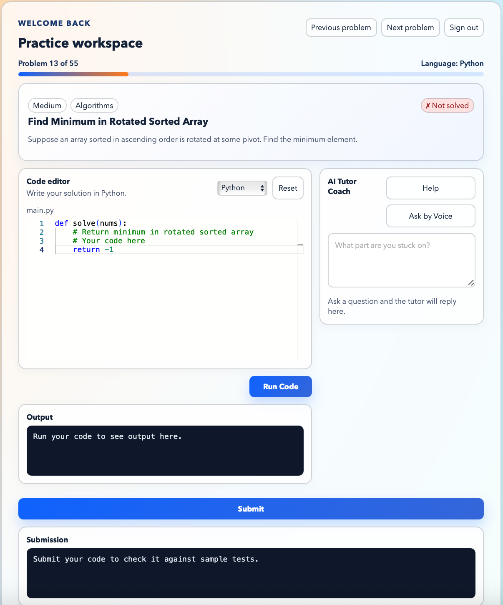

# Voice AI DSA Mentor

Learning DSA is difficult because explanations are generic and learners often don't know why their solution is wrong.
Voice AI DSA Mentor is an AI tutor that helps users learn data structures and algorithms through interactive coding, personalized explanations, and voice conversations.



## What is included

- apps/web: React + Vite frontend for chat and voice UX
- apps/backend: Python + FastAPI backend for orchestration and AI hooks
- CI workflow for lint, type-check, and build

## Run locally

### Prerequisites

- Node.js 18+
- npm 9+
- Python 3.13+

### 1. Install dependencies

From the repo root:

```bash
npm install
```

Create and activate a virtual environment for the backend, then install Python packages:

```bash
/usr/local/bin/python3.13 -m venv .venv
source .venv/bin/activate
pip install -r apps/backend/requirements.txt
```

If `python3.13` is already on your `PATH`, you can use `python3.13 -m venv .venv` instead.

### 2. Optional environment file

An `.env.example` file is included in the repo root:

```bash
cp .env.example .env
```

Enter your `OPENAI_API_KEY` and `VITE_API_BASE_URL`.

### 3. Start the project

Run both backend and frontend together from the repo root:

```bash
npm run dev
```

The root dev script uses `scripts/dev-backend.sh`, which prefers `.venv/bin/python` automatically, so you do not need to activate the virtual environment before starting the app once `.venv` has been created.

This starts:

- FastAPI backend at `http://localhost:4000`
- Vite frontend at `http://localhost:5173`

### 4. Verify it is running

Open the frontend in your browser:

```text
http://localhost:5173
```

Check the backend health endpoint:

```text
http://localhost:4000/health
```

You should get a response similar to:

```json
{"ok":true,"service":"voice-ai-dsa-mentor-api"}
```

### 5. Run services separately

If you want to run each app in its own terminal:

Backend:

```bash
npm run dev:backend
```

Frontend:

```bash
npm run dev:web
```

### 6. Run backend tests

Install the extra dev dependencies (`pytest`, `httpx`) once, on top of the base requirements:

```bash
source .venv/bin/activate
pip install -r apps/backend/requirements-dev.txt
```

Then run the suite from the repo root (tests run against an isolated in-memory
SQLite database, never `data/app.db`):

```bash
python -m pytest
```

## 7. Suggested roadmap

1. Add text-to-speech responses from the tutor with ElevenLabs
2. Tests
3. Deployment
4. Support of other programming languages like C++

