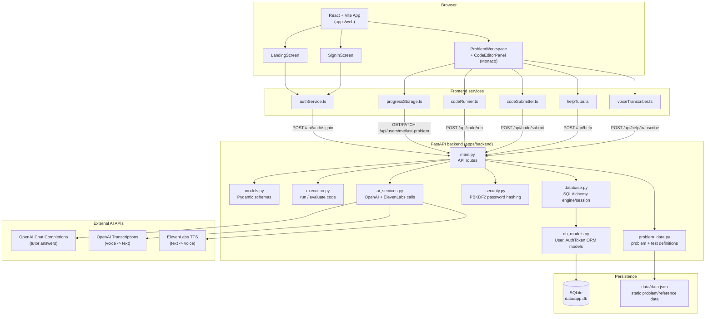

# Architecture

This diagram shows the current system architecture for Voice AI DSA Mentor: the React/Vite frontend, the FastAPI backend, the SQLite persistence layer, and the external AI services it calls.

## Component notes

- **Frontend (`apps/web`)** — React + TypeScript app built with Vite. `App.tsx` routes between the landing, sign-in, and problem workspace screens and holds top-level navigation state (current/previous/next problem). Each screen calls a dedicated service module (`services/*.ts`) rather than calling `fetch` directly.
- **Backend (`apps/backend`)** — FastAPI app (`main.py`) split into focused modules:
  - `models.py` — Pydantic request/response schemas.
  - `problem_data.py` — problem statements and submission test cases (backed by `data/data.json`).
  - `execution.py` — sandboxed code execution and test evaluation for "Run" and "Submit".
  - `ai_services.py` — outbound calls to OpenAI (tutor Q&A, audio transcription) and ElevenLabs (text-to-speech), guarded by `OPENAI_API_KEY` / `ELEVENLABS_API_KEY` env vars.
  - `security.py` — PBKDF2-HMAC-SHA256 password hashing/verification (stdlib only).
  - `database.py` / `db_models.py` — SQLAlchemy engine, session factory, and ORM models (`User`, `AuthToken`) backing a SQLite file at `data/app.db`.
- **Persistence** — `data/app.db` (SQLite) stores users, hashed passwords, last-solved problem, and bearer auth tokens. `data/data.json` holds static problem content, separate from user data.
- **External AI APIs** — OpenAI powers tutor answers and voice transcription; ElevenLabs powers optional text-to-speech playback of tutor answers.

## Request flow (typical session)

1. User signs in from `SignInScreen` → `authService.ts` → `POST /api/auth/signin` → backend verifies/creates a `User` row and issues a bearer `AuthToken`.
2. `ProblemWorkspace` loads the last-solved problem via `progressStorage.ts` → `GET /api/users/me/last-problem`.
3. User writes code in the Monaco editor; "Run" and "Submit" go through `codeRunner.ts` / `codeSubmitter.ts` to `execution.py`, which executes the code against test cases from `problem_data.py`.
4. User asks a question (typed or voice) — voice audio is sent to `POST /api/help/transcribe` (OpenAI transcription) and the resulting text, plus typed questions, go to `POST /api/help` (OpenAI chat completion) for a tutor answer.
5. Navigating to the next/previous problem persists progress via `PATCH /api/users/me/last-problem`, updating the `User.last_problem_id` column in SQLite.
