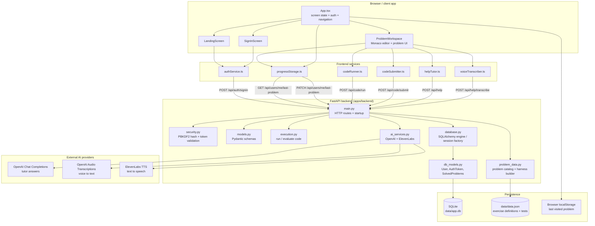

# Architecture

This document reflects the current implementation of Voice AI DSA Mentor in this repository: a Vite + React frontend, a single FastAPI backend service, SQLite persistence, and outbound calls to OpenAI and ElevenLabs.

## Component notes

- **Frontend (`apps/web`)** — React + TypeScript app built with Vite. `App.tsx` is the top-level coordinator for screen routing, auth state, and the active problem. It keeps the user’s current problem in local React state and mirrors it to browser `localStorage` as a fast cache.
- **Auth and progress flow** — `authService.ts` and `progressStorage.ts` call the backend for sign-in and last-problem persistence. A signed-in session stores a bearer token in React state and sends it on authenticated requests using the `Authorization: Bearer ...` header.
- **Backend (`apps/backend`)** — The FastAPI app in `main.py` is a single service with focused modules:
  - `models.py` — request/response contracts for auth, execution, and AI help.
  - `problem_data.py` — loads `data/data.json`, exposes exercise metadata, and builds Python harnesses for each sample test row.
  - `execution.py` — runs learner code against the selected problem and validates output.
  - `ai_services.py` — wraps outbound calls to OpenAI (tutor answers and audio transcription) and ElevenLabs (speech synthesis).
  - `security.py` — hashes passwords with PBKDF2-HMAC-SHA256 and validates token expiry plus rate limiting for sign-in attempts.
  - `database.py` / `db_models.py` — constructs the SQLAlchemy engine and defines `User`, `AuthToken`, and `SolvedProblems` ORM models.
- **Persistence** — `data/app.db` stores user accounts, hashed passwords, bearer auth tokens, and per-problem solved state. `data/data.json` is a static exercise dataset that defines problem statements and sample tests, and it is loaded directly by `problem_data.py` on startup.
- **Current architectural pattern** — this is not a multi-service deployment. A single FastAPI app handles auth, code execution, progress sync, and AI assistance, while the app’s persistence remains SQLite-backed and local to the repo.

## Major flows

1. User lands on the app and starts learning. The initial problem is selected locally from a static list and can be restored from `localStorage` when the page reloads.
2. Sign-in uses `POST /api/auth/signin`. The backend validates the email, enforces rate limiting, creates a user row if needed, hashes the password using PBKDF2, issues a bearer `AuthToken`, and returns the user’s `lastProblemId`.
3. Problem navigation persists progress through `PATCH /api/users/me/last-problem`, while a local copy is kept immediately in the browser so the UI feels instant even before the server confirms it.
4. Code execution runs through `POST /api/code/run` and `POST /api/code/submit`. The backend loads the tests from `data/data.json`, builds a Python harness for that exercise, executes the learner’s `solve` function, and compares stdout to the expected outputs.
5. When a learner asks for help, the frontend sends typed text or audio to `/api/help` or `/api/help/transcribe`. The backend calls OpenAI for the answer or transcript and may also call ElevenLabs for TTS playback of the tutor response.
6. Successful submissions are stored in `solved_problems` so the app can tell whether a problem has been solved before and return the saved code when needed.

## Data model summary

- `users` — `id`, `email`, `password_hash`, `last_problem_id`
- `auth_tokens` — `token` (primary key), `user_id`, `created_at`
- `solved_problems` — `problem_id`, `solution`, `is_solved`

This is a lightweight, local-first architecture designed for a single-user or small-shared environment rather than a distributed multi-tenant SaaS deployment.
